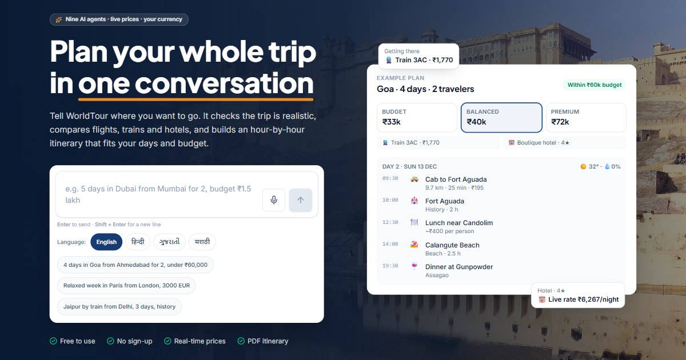

# WorldTour — AI trip planner



Describe a trip in one message — *"goa frm mumbai 4day 2ppl 40k beaches"*, Hinglish works too — and
WorldTour plans it: flights or trains, hotels, weather, every day hour by hour, three costed packages
and a budget check. Nine AI agents work on it in parallel; the ranking, budgeting and scheduling are
done by real algorithms, not guessed by a language model.

**Live:** [worldtour-xi.vercel.app](https://worldtour-xi.vercel.app) · free, no sign-up needed to plan.

---

## What it does

**Planning**
- One-message chat that understands messy text, Hinglish and Indian number words (lakh, 40k); it only
  asks for what is really missing. Chat in English, हिन्दी, ગુજરાતી or मराठी, by voice or text, and
  have replies read aloud.
- Multi-city trips, day trips to sights 35–75 km away, rain and heat-aware days, flexible dates.
- Budget / Balanced / Premium packages that switch instantly, with live Google Flights fares and
  hotel rates when available.
- Day-by-day timetable with a map, cost breakdown with charts, booking links, a printable PDF travel
  document, and *Add to calendar* (Google, Outlook or an `.ics` file with every stop).

**Accounts** (optional — guests can plan freely)
- Sign up with email + password or Google (Clerk), profile photo (Cloudinary), and three quick
  questions after sign-up (interests, who you travel with, travel style) that become planning defaults.
- Every prompt and every itinerary version saved automatically; My trips with search, favourites,
  archive and rename; read-only share links; profile with stats, activity and achievements; settings
  with home city, currency, language, theme and a data download.

**Admin dashboard** (`/admin`, behind a code)
- Overview, every user's details and trips, full conversations and itinerary versions, account
  deletion, and an **API keys** screen: add spare keys for SerpAPI, OpenRouter, Geoapify or
  Aviationstack and the planner switches to the next working key by itself when one runs out.
- 5-minute sessions that lock themselves; 5 wrong codes lock the screen for 15 minutes.

---

## How it fits together

```
                         ┌──────────────── Clerk (sign-in, email codes, Google)
Browser ── frontend/ ────┤
  React SPA (Vercel)     ├── ai/      FastAPI + LangGraph planner (Vercel, Python)
                         │      └─ SerpAPI · OpenRouter · Geoapify · Wikipedia · Open-Meteo
                         │         OSRM · Frankfurter · MyMemory · Aviationstack
                         └── server/  Express accounts API (Vercel, Node)
                                └─ MongoDB Atlas · Cloudinary · Clerk webhooks
                                └─ /api/internal/keys ──► spare API keys for ai/
```

| Folder | What it is | Stack |
|---|---|---|
| [`ai/`](ai/README.md) | The planner: chat intake, nine agents in a LangGraph workflow, providers with fallbacks, structured agent logs | Python 3.11+, FastAPI, LangGraph, LangChain tools, httpx |
| [`frontend/`](frontend/README.md) | The website | React 19, TypeScript, Vite, Tailwind CSS 4, Zustand, React Router, Clerk, Leaflet, Recharts |
| [`server/`](server/README.md) | Accounts, saved trips, sharing, stats, admin API | Node, Express 5, Mongoose, Zod, Clerk, Cloudinary |

### The planner in short

```
message ─► parser (+ geocoder for unlisted towns, AI reading only when needed)
        ─► feasibility check ─► Coordinator
        ─► Flight · Hotel · Weather · Recommendation · Route · Transport   (in parallel, only those needed)
        ─► Budget (0/1 knapsack) ─► Itinerary (nearest-neighbour + interval scheduling) ─► final plan
```

| Agent | Algorithms |
|---|---|
| Flight | priority queue, weighted scoring |
| Hotel | heap / Top-K |
| Budget | 0/1 knapsack (dynamic programming) |
| Route | Dijkstra and A* (Haversine heuristic) |
| Itinerary | nearest neighbour, greedy interval scheduling |
| Recommendation | BFS, DFS, Top-K over Geoapify + Wikipedia landmarks |
| Weather | forecast or seasonal history, conflict checks |

Every agent run and outside API call is logged as one JSON line with a `run_id`
(`ai/src/worldtour_ai/utils/agent_logs.py`); `python scripts/agent_report.py` summarises failures,
slow calls and fallbacks.

---

## Run it locally

Requirements: **Python 3.11+**, **Node 20+**, and free accounts for the services you want live
(the planner falls back gracefully when a key is missing).

```bash
# 1. Planner API  →  http://127.0.0.1:8000
cd ai
python -m venv venv
venv\Scripts\activate            # macOS/Linux: source venv/bin/activate
pip install -r requirements.txt
copy .env.example .env           # then fill in the keys you have
python scripts/serve.py

# 2. Accounts server  →  http://localhost:5000/api/health   (optional)
cd server
npm install
copy .env.example .env           # MongoDB, Clerk, Cloudinary, ADMIN_CODE ...
npm run dev

# 3. Website  →  http://localhost:5173   (proxies /api to the planner)
cd frontend
npm install
copy .env.example .env           # VITE_SERVER_URL / VITE_CLERK_PUBLISHABLE_KEY for accounts
npm run dev
```

Without the accounts server and Clerk key the site runs in guest mode: planning works, sign-in is hidden.

**Checks**

```bash
cd server   && npm test                 # 20 API tests on an in-memory MongoDB
cd frontend && npm run lint && npm run build
cd ai       && python scripts/check_providers.py   # which data sources are live
```

---

## Configuration

Each folder has its own `.env.example`. Only variable **names** are listed here — keep the values
private (they live in `.env` files, which git ignores, and in Vercel → Settings → Environment Variables).

| Project | Variables |
|---|---|
| `ai/` | `SERPAPI_API_KEY`, `OPENROUTER_API_KEY`, `GEOAPIFY_API_KEY`, `AVIATIONSTACK_API_KEY`, `MYMEMORY_EMAIL`, `ALLOWED_ORIGINS`, `INTERNAL_API_SECRET`, `ACCOUNTS_SERVER_URL`; optional `ACCESS_CODE`, `UPSTASH_REDIS_REST_URL` / `UPSTASH_REDIS_REST_TOKEN` + `PLANS_PER_DAY`, `AGENT_LOG_FILE`, `AGENT_LOG_DIR` |
| `server/` | `MONGODB_URI`, `CLERK_PUBLISHABLE_KEY`, `CLERK_SECRET_KEY`, `CLERK_WEBHOOK_SIGNING_SECRET`, `CLOUDINARY_CLOUD_NAME`, `CLOUDINARY_API_KEY`, `CLOUDINARY_API_SECRET`, `CLOUDINARY_FOLDER`, `ALLOWED_ORIGINS`, `APP_URL`, `ADMIN_CODE`, `INTERNAL_API_SECRET`; optional `KEY_ENCRYPTION_SECRET`, `AI_URL` |
| `frontend/` | `VITE_API_URL`, `VITE_SERVER_URL`, `VITE_CLERK_PUBLISHABLE_KEY` (all public by design — never put secret keys here) |

`INTERNAL_API_SECRET` must be the **same** long random value in `ai/` and `server/`: it lets the planner
read the spare API keys added in the admin dashboard. Spare keys are stored encrypted (AES-256-GCM).

---

## Deploy (Vercel)

Three Vercel projects from this one repository, each with its **Root Directory** set to its folder:

| Project | Root directory | Notes |
|---|---|---|
| Planner | `ai` | Python runtime; `vercel.json` allows 300 s for planning |
| Accounts server | `server` | Node runtime; add the Clerk webhook `https://<server>/api/webhooks/clerk` |
| Website | `frontend` | Vite preset; `vercel.json` rewrites every route to the app |

Pushing to `main` redeploys all three. After changing environment variables, redeploy that project.
Step-by-step guides for MongoDB Atlas, Clerk and Cloudinary are in [`server/README.md`](server/README.md).

---

## Security notes

- Passwords are handled only by Clerk (hashed; never seen or stored by WorldTour).
- All secrets stay on the servers; the browser bundle holds only public values.
- The admin code is checked by the server, never shipped to the browser; sessions are signed, last
  5 minutes and wrong codes are rate-limited.
- API keys never appear in logs: URLs lose their query string and key-like values are masked.
- Shared trip links show the itinerary only — no conversation, notes or account details.

---

## Project layout

```
ai/         planner API, agents, providers, algorithms, scripts (serve, report, inspect)
frontend/   website: src/components (chat, plan views), src/pages (accounts, admin), public/ (SEO, images)
server/     accounts API: src/routes, src/models, src/lib, test/
```
